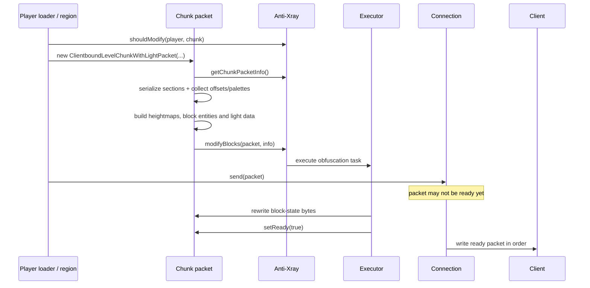

# ระบบ chunk รุ่นเก่า: Folia/Moonrise และ Anti-Xray mode 4 แบบซ่อนเป็น air

เอกสารภาษาไทยสำหรับอ่านโค้ด ดูแลเซิร์ฟเวอร์ และวิเคราะห์ปัญหาใน repository `Folia-2b2t` รุ่น Minecraft 26.2

วันที่จัดทำ: **1 พฤศจิกายน 2026**

## 1. ขอบเขตและความหมายของคำว่า “ระบบเก่า”

เอกสารนี้รวมสองส่วนที่ทำงานต่อกัน แต่รับผิดชอบคนละเรื่อง:

1. **Folia/Moonrise chunk system** — ตัดสินใจว่าจะโหลด สร้าง เก็บไว้ใน RAM ให้ tick ส่งให้ผู้เล่น และ unload chunk ใด
2. **Anti-Xray mode 4 รุ่น occluded-air** — แก้ block-state data ใน chunk packet โดยแทนบล็อกที่เข้าเงื่อนไขด้วย `minecraft:air` ก่อนส่งออก

ส่วน Folia/Moonrise อธิบายโครงสร้างฐานที่ระบบเก่าใช้งาน และหลายส่วนยังเป็นฐานของระบบใหม่ด้วย ไม่ได้หมายถึง vanilla chunk loader รุ่นเก่าที่ถูกนำกลับมาใช้

ส่วน Anti-Xray ยึด snapshot [v4-occluded-air.patch](anti-xray-mode-4-versions/v4-occluded-air.patch) เป็นหลัก: เป็นรุ่นที่ซ่อนบล็อกทึบด้านในเป็น air และ **นำข้อยกเว้นผู้เล่นใต้พื้นออกแล้ว**

รุ่น v1/v2/v3 และ Player Sight อธิบายในหัวข้อประวัติแยกต่างหาก ไม่ใช้เงื่อนไขของรุ่นเหล่านั้นมาปะปนกับ v4

ระบบใหม่ที่เติมถ้ำเป็นหิน เปิดเผยพื้นที่แยกต่อผู้เล่น และกรอง entity/particle มีเอกสารที่ [anti-xray-mode-4.md](anti-xray-mode-4.md) การอ่านไฟล์นี้ไม่ได้สลับเซิร์ฟเวอร์กลับไปใช้ระบบเก่า

### สารบัญ

- [ภาพรวมและคำศัพท์](#2-ภาพรวมและคำศัพท์)
- [พิกัดและขนาดข้อมูล](#3-พิกัดและขนาดข้อมูล)
- [หน้าที่ของแต่ละชั้น](#4-หน้าที่ของแต่ละชั้น)
- [เธรดและ ownership](#5-เธรดและ-ownership-ของ-folia)
- [สถานะและ ticket](#6-สถานะของ-chunk-และ-ticket)
- [ระยะโหลด ระยะส่ง และ client cache](#7-ระยะโหลด-ระยะส่ง-และ-client-cache)
- [คิวและ lifecycle](#8-คิวและ-lifecycle-ของ-player-chunk-loader)
- [I/O, world generation และแสง](#9-io-world-generation-และแสง)
- [เส้นทางส่ง packet](#10-เส้นทางส่ง-chunk-packet-จริง)
- [การแก้บล็อกและ unload](#11-การแก้บล็อก-unwatch-forget-และ-unload)
- [กฎ mode 4 เก่า](#12-กฎการซ่อนของ-anti-xray-mode-4-เก่า)
- [Palette และการแก้ byte buffer](#13-palette-และการแก้-byte-buffer)
- [การไล่ตรวจทีละชั้น](#14-occlusion-pass-แบบสามชั้น)
- [Permission และประวัติข้อยกเว้น](#15-permission-และประวัติข้อยกเว้นใต้พื้น)
- [Configuration](#16-configuration-และความหมายของแต่ละค่า)
- [ตัวอย่างการทำงาน](#17-ตัวอย่างการทำงานแบบไล่เหตุการณ์)
- [ข้อจำกัดและข้อมูลที่ยังเปิดเผย](#18-ข้อจำกัดและข้อมูลที่ยังเปิดเผย)
- [ประสิทธิภาพและการวิเคราะห์ lag](#19-ประสิทธิภาพและการวิเคราะห์-lag)
- [คู่มือวิเคราะห์อาการ](#20-คู่มือวิเคราะห์อาการ)
- [เปรียบเทียบและประวัติรุ่น](#21-เปรียบเทียบและประวัติรุ่น)
- [แผนที่ซอร์สและการตรวจสอบเอกสาร](#22-แผนที่ซอร์สและการตรวจสอบเอกสาร)

## 2. ภาพรวมและคำศัพท์

เส้นทางข้อมูลโดยย่อ:

```text
ตำแหน่งผู้เล่น + ระยะที่ตั้งไว้
        ↓
PlayerChunkLoaderData → tickets → ChunkTaskScheduler
        ↓                           ↓
คิวรอส่ง                  อ่านดิสก์ / สร้าง / แสง / FULL
        └───────────────────────────┘
                    ↓
          PlayerChunkSender.sendChunk()
                    ↓
       serialize chunk + บันทึกตำแหน่ง palette
                    ↓
       Anti-Xray แก้ block-state bytes ใน packet
                    ↓
         packet.ready = true → Connection → client
```

| คำ | ความหมายในเอกสารนี้ |
|---|---|
| Chunk | คอลัมน์พื้นที่แนวนอน 16×16 บล็อก มีหลาย section ตามความสูงโลก |
| Section | กล่อง 16×16×16 หรือ 4,096 block states |
| Loaded | มีข้อมูลบางระดับอยู่ในระบบ ไม่ได้แปลว่าพร้อม tick หรือพร้อมส่งเสมอ |
| Generated/FULL | พร้อมเป็น `LevelChunk`; อาจโหลดมาจากดิสก์โดยไม่สร้างภูมิประเทศใหม่ |
| Ticking | ได้สถานะที่อนุญาตให้ทำงานใน simulation ตามระดับและเงื่อนไขของเซิร์ฟเวอร์ |
| Sent/tracked | เซิร์ฟเวอร์ลงทะเบียนว่าส่งและกำลังติดตาม chunk นี้สำหรับผู้เล่น |
| Client-cached | client อาจยังเก็บภาพ chunk แม้เซิร์ฟเวอร์หยุด tracking แล้ว |
| Ticket | เหตุผลและระดับความต้องการให้ chunk คงอยู่หรือพัฒนาไปถึงสถานะหนึ่ง |
| Palette | ตารางแปลงหมายเลขขนาดเล็กใน section เป็น `BlockState` |
| Occlusion | การพิจารณาว่าบล็อกถูกปิดล้อมด้วยเพื่อนบ้าน ไม่ใช่การยิง ray จากกล้อง |

คำว่า **chunk ไม่ hide** จึงมีได้หลายความหมาย: chunk ไม่เคยถูกแก้ packet, บล็อกบางประเภทถูกเก็บไว้, อยู่เหนือเพดานความสูงที่ตั้งไว้ หรือ client ยังแสดงข้อมูลที่เคยรับก่อนหน้า ต้องแยกกรณีก่อนแก้

## 3. พิกัดและขนาดข้อมูล

การแปลงพิกัดบล็อกเป็นพิกัด chunk และตำแหน่งภายใน:

```java
chunkX = blockX >> 4;
chunkZ = blockZ >> 4;
localX = blockX & 15;
localZ = blockZ & 15;
sectionY = blockY >> 4;
localY = blockY & 15;
```

การใช้ arithmetic shift ทำให้พิกัดติดลบถูกแบ่งตามพื้นของช่วง ไม่ใช่หารแบบตัดเข้าหาศูนย์ เช่น X = -1 อยู่ chunk -1 และมี localX = 15

`sectionY` เป็นพิกัด section ในโลก ส่วน `chunkSectionIndex` เป็น index ใน array ของ chunk:

```text
chunkSectionIndex = sectionY - chunk.getMinSectionY()
```

ตัวอย่างโลกสูงตั้งแต่ Y=-64 ถึง Y=319 มีความสูง 384 บล็อก จึงมี 24 sections และมากสุด 98,304 ตำแหน่งบล็อกต่อ chunk ตัวเลขนี้เป็นตัวอย่างของโลกขนาดดังกล่าว ไม่ใช่ค่าคงที่ของทุก dimension หรือ datapack

ใน old Anti-Xray ชั้นแนวนอนใช้ array 16×16 เรียงเป็น `[z][x]` ขณะที่การอ่าน block-state storage ไล่ตำแหน่งภายใน section ให้สอดคล้องกับข้อมูลที่ serialize มา

## 4. หน้าที่ของแต่ละชั้น

| ชั้น | ทำอะไร | ไม่ได้หมายความว่า |
|---|---|---|
| Region files | เก็บข้อมูล chunk, entity และ POI สำหรับโหลดกลับ | ข้อมูลในดิสก์ถูกเปลี่ยนเป็น air โดย Anti-Xray |
| Chunk holder | ติดตาม ticket, งานที่รอ, สถานะปัจจุบัน และการ unload | ทุก holder มี chunk ที่พร้อมส่งแล้ว |
| World chunk ใน RAM | สถานะจริงสำหรับเกมและการบันทึกโลก | ตรงกับข้อมูลปลอมที่ส่งให้ client เสมอ |
| Player loader | ตัดสินใจพื้นที่ที่ผู้เล่นต้องโหลด ส่ง และ tick | มี ownership ต่อทุก chunk ในระยะทันที |
| Anti-Xray | เปลี่ยนภาพ block states ใน packet บางส่วน | เปลี่ยน collision, ดรอป หรือโลกจริง |
| Connection | รอ packet พร้อมและส่งตามลำดับ | การเรียก `send()` แปลว่าข้อมูลถึง client แล้วทันที |
| Client | เก็บ chunk, แสง และสร้าง mesh สำหรับวาดภาพ | ได้รับเฉพาะส่วนที่กล้องมองอยู่จริง |

หลักที่ต้องรักษาคือ **world state จริงกับ packet state ปลอมเป็นคนละชุดข้อมูล** การขุด คำนวณฟิสิกส์ และบันทึกโลกต้องอ้างอิงโลกจริง

## 5. เธรดและ ownership ของ Folia

### 5.1 Region tick thread

Folia แบ่งโลกเป็นบริเวณที่มีเจ้าของการ tick แต่ละ region มีการทำงานใน tick ของตนเอง บน thread pool ที่สามารถประมวลผลหลาย region แยกกันได้

หนึ่ง region ไม่จำเป็นต้องเท่ากับหนึ่ง chunk หรือหนึ่งผู้เล่น และไม่ควรคิดว่าแต่ละ region ผูกกับ OS thread เดิมตลอดไป การแยกหรือรวม region กับการย้ายผู้เล่นทำให้เจ้าของข้อมูลเปลี่ยนได้

งานที่เกี่ยวกับ world/entity ต้องอยู่ใน context ของเจ้าของที่ถูกต้อง การเป็น “tick thread สักเธรดหนึ่ง” ยังไม่ยืนยันว่ามีสิทธิ์แตะ chunk เป้าหมาย

ในเส้นทางส่ง chunk ตัว loader ตรวจ `TickThread.isTickThreadFor(world, chunkX, chunkZ)` ก่อนส่ง ถ้ายังไม่ใช่ region ที่เป็นเจ้าของ จะรอให้ระบบดำเนินการต่อภายหลัง

### 5.2 งานเบื้องหลัง

| กลุ่มงาน | หน้าที่ |
|---|---|
| Region tick | เกม ผู้เล่น การเปลี่ยนสถานะที่ต้องอยู่กับโลก และการคุม loader ของผู้เล่นใน region |
| Chunk worker/load executor | ประมวลผลข้อมูลที่อ่านมา งานสร้าง และ progression ตามข้อจำกัดของแต่ละขั้น |
| I/O executor | อ่าน/เขียนข้อมูล region files |
| Compression/save executor | เตรียมและบันทึกข้อมูลตามเส้นทางของ scheduler |
| Netty event loop | เขียนข้อมูลเครือข่าย ไม่ใช่เธรดสำหรับอ่านหรือแก้โลกโดยอิสระ |
| Anti-Xray executor | ประมวลผล byte buffer และข้อมูลประกอบของ packet ตาม implementation เก่า |

การใช้ async ไม่ได้ทำให้งานฟรี: CPU, RAM, memory bandwidth และคิวเครือข่ายยังมีต้นทุน รวมทั้งงาน async ที่ช้าอาจทำให้ packet ซึ่งตามหลังต้องรอ

### 5.3 จุดที่ต้องระวังใน legacy Anti-Xray

`modifyBlocks()` เก่าตรวจ `Bukkit.isPrimaryThread()` และมีทางเรียก `scheduleOnMain()` เมื่อถูกเรียกจาก context อื่น ใน fork นี้ `CraftServer.isPrimaryThread()` ใช้ `TickThread.isTickThread()` จึงไม่ควรตีความชื่อ API ว่าหมายถึง main thread เดียวแบบ vanilla

โค้ดเก่ายังอ่าน palette และ section ของเพื่อนบ้านบางส่วน โดยมีการรับมือ `MissingPaletteEntryException` แบบอนุรักษนิยม การมี `ThreadLocal` สำหรับ scratch arrays ช่วยไม่ให้ worker ใช้ array ชุดเดียวกัน แต่ไม่ได้ทำให้ mutable world data ทุกอย่างปลอดภัยข้าม region

## 6. สถานะของ chunk และ ticket

ระบบนี้มีสถานะหลายชุด ต้องไม่ใช้แทนกัน:

### 6.1 Generation status: “ข้อมูลพัฒนาไปถึงไหนแล้ว”

ใน source รุ่นนี้มีลำดับหลักดังนี้:

```text
EMPTY
→ STRUCTURE_STARTS
→ STRUCTURE_REFERENCES
→ BIOMES
→ NOISE
→ SURFACE
→ CARVERS
→ FEATURES
→ INITIALIZE_LIGHT
→ LIGHT
→ SPAWN
→ FULL
```

`EMPTY` ในเส้นทางโหลดไม่ได้แปลว่ามีแต่ air แต่เป็นระดับเริ่มต้นของ progression หลังอ่านข้อมูล chunk เข้าระบบ ข้อมูลบนดิสก์อาจมี persisted status ถึง `FULL` อยู่แล้ว

`GENERATING` ใน player loader ก็ไม่ได้ยืนยันว่ากำลังสร้างภูมิประเทศใหม่ทุกครั้ง ถ้า chunk บนดิสก์พร้อมอยู่แล้ว ระบบอาจเพียงโหลดและแปลงให้พร้อมใช้

### 6.2 Full status: “อนุญาตให้ใช้ chunk ระดับใด”

| `FullChunkStatus` | ความหมายหลัก | ขอบเขต ticket level ใน source |
|---|---|---|
| `INACCESSIBLE` | ยังไม่เปิดใช้เป็น full chunk ในโลก | สูงกว่า 33 |
| `FULL` | เปิดใช้เป็น full chunk แต่ไม่ได้รับประกันว่า entity tick | level 33 |
| `BLOCK_TICKING` | ได้ระดับ block-ticking | level 32 |
| `ENTITY_TICKING` | ได้ระดับ entity-ticking | level ≤31 |

Ticket level ที่ต่ำกว่าหมายถึงความต้องการที่แรงกว่า แต่การเปลี่ยน full status ยังต้องรอข้อมูลและเพื่อนบ้านพร้อม ไม่ใช่เปลี่ยนเลข ticket แล้วเกมจะ tick ได้ทันที

### 6.3 Player-loader stage: “คิวของผู้เล่นเดินถึงขั้นไหน”

```text
NONE → LOADING → LOADED → GENERATING → GENERATED → TICK
```

stage นี้เป็น bookkeeping ของ `PlayerChunkLoaderData` ไม่ใช่ `ChunkStatus` และไม่ใช่ `FullChunkStatus` การส่งให้ client เป็นอีกแขนงหลัง `GENERATED` ไม่ใช่ stage `SENT` ใน enum ชุดนี้

### 6.4 Ticket มาจากหลายเหตุผล

ผู้เล่นเป็นเพียงแหล่ง ticket หนึ่ง ยังมีงานโหลดชั่วคราว งานแสง forced chunks กลไกเกม และระบบหรือปลั๊กอินอื่น การนำ ticket ของผู้เล่นออกจึงไม่ได้รับประกันว่า chunk จะ unload

`ChunkHolderManager` ดูแลชุด ticket และประสานกับ `NewChunkHolder`/scheduler ส่วนงานที่เกี่ยวข้องกับเพื่อนบ้านยังมี dependency และ area locks เพื่อไม่ให้สร้างหรือเปลี่ยนข้อมูลทับกันโดยไม่ถูกต้อง

## 7. ระยะโหลด ระยะส่ง และ client cache

### 7.1 ระยะหลักสามประเภท

| ระยะ | จุดประสงค์ |
|---|---|
| Tick/simulation distance | พื้นที่ simulation รอบผู้เล่น |
| Load distance | พื้นที่ที่ loader ต้องเตรียมข้อมูล รวม margin ที่ระบบต้องใช้ |
| Send distance | พื้นที่ที่ต้องส่งให้ client และติดตามต่อเนื่อง |

สูตรภายใน loader มีความสัมพันธ์สำคัญ:

```text
loadDistance ≥ tickDistance + 1
sendDistance ≤ loadDistance - 1
```

ค่า API, world setting, per-player override และค่าที่ client ขอ ถูกนำมารวมกันก่อนใช้จริง จึงไม่ควรนำเลขจาก `server.properties` ไปเทียบกับระยะภายในทุกจุดโดยไม่ดูการชดเชยขอบ

โค้ดใช้ `ChunkTrackingView.isWithinDistance()` สำหรับพื้นที่โหลด/ส่งบางส่วน และใช้ระยะ Chebyshev สำหรับ `wantChunkTicked()` จึงไม่ใช่วงกลมหรือสี่เหลี่ยมรูปเดียวกันทุกคิว

### 7.2 Client chunk cache distance ของ fork

patch [0009-Add-client-chunk-cache-distance.patch](../folia-server/minecraft-patches/features/0009-Add-client-chunk-cache-distance.patch) เพิ่มการแยกสอง set:

| Set | ความหมาย |
|---|---|
| `sentChunks` | chunk ที่กำลัง tracking สำหรับผู้เล่น |
| `clientCachedChunks` | chunk ที่ client อาจยังเก็บภาพอยู่ แม้เลิก tracking แล้ว |

เมื่อออกนอกระยะส่ง `stopTrackingChunk()` นำออกจาก `sentChunks` และหยุด watch แต่ถ้ายังอยู่ในระยะ cache อาจยังไม่ส่ง `ClientboundForgetLevelChunkPacket`

เมื่อออกนอกระยะ cache จึงเรียก `forgetClientCachedChunk()` และสั่ง client ลืม chunk การ cache นี้ **ไม่ได้ถือ player chunk ticket เพิ่มโดยตัวมันเอง** และข้อมูลที่หยุด tracking อาจค้างอยู่ใน client โดยไม่ได้รับ live updates ต่อ

`client-chunk-cache-distance: -1` ให้ใช้ระยะส่งเป็นฐาน ถ้ากำหนดค่ามากกว่านั้น โค้ดจำกัดตามค่าที่ client ขอเมื่อมีข้อมูล แล้วไม่ให้ cache distance ต่ำกว่า send distance

### 7.3 สิ่งที่ไม่ควรเหมารวม

```text
client ยังเห็น chunk       ≠ server ยัง tracking chunk นั้น
server tracking chunk       ≠ chunk นั้นมี entity ticking
server unload chunk         ≠ client ลืมภาพ chunk ในจังหวะเดียวกัน
เพิ่ม client cache distance ≠ เพิ่ม server simulation distance
```

## 8. คิวและ lifecycle ของ player chunk loader

`RegionizedPlayerChunkLoader.tick()` วนผู้เล่น local ของ region นั้น แล้วเรียก `loader.update()` กับ `loader.updateQueues(time)`

### 8.1 การคำนวณพื้นที่

`update()` เทียบตำแหน่ง chunk ของผู้เล่น ระยะต่าง ๆ และสิทธิ์การสร้าง chunk หากไม่มีสิ่งที่ loader สนใจเปลี่ยน จะไม่คำนวณพื้นที่ใหม่ทั้งหมด

เมื่อเปลี่ยน ระบบอัปเดต area maps สำหรับการ watch, client cache, การถือ ticket และการ tick พร้อมจัดคิวตามระยะจากผู้เล่นใหม่

คิวหลักใช้ priority queue เปรียบเทียบระยะกำลังสองในแนว X/Z จากศูนย์กลางผู้เล่น โดยไม่ได้ใช้ทิศที่กล้องหันหรือ pitch/yaw เป็นเกณฑ์

### 8.2 หน้าที่ของแต่ละคิว

| คิว | เนื้อหาและบทบาท |
|---|---|
| `loadQueue` | ต้องเริ่มขอโหลด |
| `loadingQueue` | เริ่มโหลดแล้ว รอมี `ChunkAccess` |
| `genQueue` | โหลดแล้ว รอเริ่ม progression ไปสู่ FULL |
| `generatingQueue` | เริ่ม progression แล้ว รอมี `LevelChunk` |
| `sendQueue` | พร้อมในระดับที่ต้องใช้ แต่ยังรอตรวจเงื่อนไขก่อนส่ง |
| `tickingQueue` | รอยกระดับ ticket สำหรับ ticking เมื่อเพื่อนบ้านพร้อม |

### 8.3 เส้นทางโหลด

1. ใช้ rate limiter และเพดาน concurrent loads คำนวณจำนวนงานที่เริ่มได้
2. เปลี่ยน stage `NONE → LOADING` และเพิ่ม player ticket ระดับโหลด
3. flush ticket operations และ process ticket updates ก่อน schedule งานที่อาศัย ticket เหล่านั้น
4. เรียก `scheduleChunkLoad(..., ChunkStatus.EMPTY, ...)`
5. เมื่อพบข้อมูลที่โหลดแล้ว เปลี่ยน `LOADING → LOADED`
6. นำเข้า `genQueue` ถ้าผู้เล่นอนุญาตให้สร้าง หรือข้อมูลที่โหลดมาสามารถเตรียมต่อได้ตามเงื่อนไข

ขั้นตอนที่เรียก plugin logic ได้จะมีการตรวจว่าผู้เล่นถูก remove หรือคิวเปลี่ยนระหว่างทางหรือไม่ เพื่อไม่ทำ bookkeeping ต่อบนข้อมูลที่หมดอายุแล้ว

### 8.4 เส้นทางสู่ FULL และเส้นทาง tick

1. `genQueue` เปลี่ยน ticket และ stage เป็น `GENERATING`
2. Rate limit สำหรับการสร้างคิดกับกรณีที่ persisted status ยังไม่เป็น FULL ตามโค้ดในจุดนี้
3. เมื่อมี `LevelChunk` เปลี่ยน stage เป็น `GENERATED`
4. ถ้าต้องส่ง ให้นำเข้า `sendQueue`
5. ถ้าต้อง tick ให้นำเข้า `tickingQueue`
6. ฝั่ง tick รอเพื่อนบ้านตามรัศมีจากส่วนต่าง ticket levels ก่อนเลื่อนเป็น `TICK`

การเปลี่ยนระดับ ticket เป็นการส่งความต้องการให้ระบบจัดการสถานะต่อ ไม่ใช่สั่ง tick chunk แบบข้าม dependency

### 8.5 เงื่อนไขก่อนส่ง

`sendQueue` ตรวจเงื่อนไขอย่างน้อยดังนี้:

- ยังมี allocation จาก send-rate limiter
- เพื่อนบ้านรอบเป้าหมายรัศมี 1 มี stage ที่พร้อมตาม loader
- เธรดปัจจุบันเป็นเจ้าของ chunk เป้าหมาย
- ทำ post-processing ที่จำเป็นแล้ว เพื่อส่งข้อมูลรวมถึง block entities ได้ถูกต้อง
- ไม่มีการ remove ผู้เล่นหรือเปลี่ยนคิวจาก callback ระหว่างทาง

โค้ดหลายส่วนตรวจหัว priority queue แล้ว `break` เมื่อหัวคิวยังไม่พร้อม จึงอาจเห็น chunk อื่นรอด้วย แม้บาง chunk ด้านหลังจะมีข้อมูลบางส่วนพร้อมแล้ว

### 8.6 Rate limit กับ concurrency เป็นคนละค่า

Rate limit จำกัดอัตราเริ่มงานหรือส่งข้อมูลต่อช่วงเวลา ส่วน concurrency จำกัดงานที่กำลังรอพร้อมกัน การเพิ่มอย่างใดอย่างหนึ่งไม่ได้เพิ่มกำลัง CPU หรือ I/O ให้เครื่อง

loader ใช้ `StaggeredRateLimiter` หลายช่วงเวลา: 100 ms, 500 ms, 1 s และ 3 s เพื่อควบคุม burst ในระยะสั้นกับอัตราระยะยาว

`MAX_RATE = 10_000` เป็นเพดานภายในของ loader ไม่ใช่ค่าที่แนะนำให้ตั้ง และไม่ใช่จำนวน chunk ที่รับประกันว่าจะส่งได้ทุก tick

## 9. I/O, world generation และแสง

### 9.1 ข้อมูลสามกลุ่ม

`MoonriseRegionFileIO.RegionFileType` แยก `CHUNK_DATA`, `POI_DATA` และ `ENTITY_DATA`

`ChunkLoadTask` ประสานการโหลดข้อมูล chunk, entity NBT และ POI จึงไม่ควรมองการโหลด chunk ว่าเป็นการอ่าน block array เพียงก้อนเดียว

การอ่าน NBT ของ entity ยังไม่เท่ากับ entity ได้เริ่ม tick แล้ว ข้อมูลต้องถูกนำเข้าโลกและเปลี่ยนสถานะตาม lifecycle อีกครั้ง

### 9.2 โหลดโลกเก่าและสร้างโลกใหม่ใช้ progression ต่างกัน

`ChunkPyramid` แยก loading pyramid กับ generation pyramid งานบางขั้นเป็น no-op เมื่อข้อมูลบนดิสก์พร้อมอยู่แล้ว แต่การโหลดกลับยังมีงานตรวจสถานะ แสง การแปลง และการนำเข้าโลก

การ pre-generate ลดงานสร้างภูมิประเทศใหม่ได้ แต่ไม่ได้ตัดต้นทุนอ่านดิสก์ deserialize, lighting, serialization, Anti-Xray, compression หรือการสร้าง mesh ฝั่ง client

### 9.3 เพื่อนบ้านมีผลต่อการสร้าง

world generation บางขั้นต้องอ่านข้อมูลเพื่อนบ้านที่มีสถานะเหมาะสม และบางขั้นเขียนถึงเพื่อนบ้านด้วย ใน `ChunkTaskScheduler` รุ่นนี้กำหนด write radius ของ `FEATURES` เป็น 1 และ `LIGHT` เป็น 2 ส่วนขั้นอื่นมีการกำหนดความสามารถในการทำขนานแยกกัน

ตัวเลข write radius ไม่ใช่รายการ dependency ทั้งหมด ห้ามสรุปว่าขั้นที่เขียนเฉพาะ chunk ตัวเองจึงไม่ต้องอ่านหรือรอเพื่อนบ้าน

### 9.4 การเป็น FULL

`ChunkFullTask` เปลี่ยนหรือคลาย wrapper ของข้อมูลให้เป็น `LevelChunk` ทำ post-load, ผูก holder, นำ entity data เข้าระบบ และลงทะเบียน block entities/tick containers ตามเส้นทางของโลก

ขั้นที่ต้องทำกับโลกใช้ task context ที่ scheduler จัดให้ ไม่ควรนำมาเรียกจาก worker หรือ Netty เองเพียงเพราะข้อมูล NBT โหลดครบแล้ว

## 10. เส้นทางส่ง chunk packet จริง

### 10.1 ตัวคุมคิวหลักคือ Moonrise

เส้นทางหลักใน fork นี้คือ:

```text
ServerChunkCache.tick()
  → RegionizedPlayerChunkLoader.tick()
    → PlayerChunkLoaderData.updateQueues()
      → PlayerChunkLoaderData.sendChunk(x, z)
        → PlayerChunkSender.sendChunk(connection, world, chunk)
```

ใน `PlayerChunkSender` ยังมี `sendNextChunks()`, batch quota และ client acknowledgement logic แต่ไม่ควรนำตัวเลขจาก method เหล่านั้นมาอธิบายเป็น rate limiter หลักของเส้นทาง Moonrise ด้านบน

เมื่อส่ง loader จะลงทะเบียน `sentChunks`/`clientCachedChunks`, ผู้รับของ chunk holder และ watch hook ก่อนส่ง packet ผ่าน static `sendChunk()`

คำว่า sent ใน bookkeeping จึงไม่ใช่ acknowledgement ว่า client รับและ render เสร็จแล้ว

### 10.2 การสร้าง packet ในระบบเก่า



ตัว constructor รับ `Executor` เป็น dependency จึงไม่ควรอนุมานจากชื่อ `execute()` ว่าทุกกรณีต้องรันพร้อมกันบน thread pool; ต้องดู executor ที่ส่งเข้ามาจริงด้วย

ถ้า bypass หรือไม่ได้ใช้ Anti-Xray จะไม่มีข้อมูลสำหรับแก้ block states และ controller ทำ packet ให้พร้อมส่งโดยไม่ผ่าน obfuscation pass

### 10.3 Ready flag และลำดับเครือข่าย

`ClientboundLevelChunkWithLightPacket` มี `volatile ready` ส่วน `Connection` ตรวจ `packet.isReady()` ก่อนนำ packet ออกจากหัวคิว

ถ้า packet chunk ที่หัวคิวยังไม่พร้อม packet ที่ต่อท้ายจะยังไม่ถูกเขียนข้ามไป การประมวลผล Anti-Xray ช้าจึงอาจกระทบความลื่นในการรับข้อมูลของผู้เล่น แม้เป็นงานบน executor

Ready flag ทำหน้าที่ส่งต่อสถานะความพร้อมของข้อมูล ไม่ใช่กลไกยืนยันว่า client เห็น chunk แล้ว และไม่แทนที่กฎ ownership ของ world data

## 11. การแก้บล็อก unwatch, forget และ unload

### 11.1 Live block updates

`ChunkHolder.broadcastChanges()` แยกส่งตามชนิดข้อมูล:

| ข้อมูล | ตัวอย่าง packet |
|---|---|
| เปลี่ยนบล็อกเดียว | `ClientboundBlockUpdatePacket` |
| หลายบล็อกใน section | `ClientboundSectionBlocksUpdatePacket` |
| ข้อมูล block entity | update packet ของ block entity |
| ข้อมูลแสง | `ClientboundLightUpdatePacket` |

ระบบเก่าไม่ได้มี mask แยกต่อผู้เล่นไว้กรอง packet เหล่านี้ทุกครั้ง มันพึ่งการ obfuscate chunk packet และกลไกเปิดเผยบล็อกข้างเคียงเมื่อเกิดการเปลี่ยนแปลง

### 11.2 ออกจากพื้นที่ของผู้เล่น

area maps จะลดความต้องการโหลด/tick และเปลี่ยน player ticket เป็น delayed ticket ตามกรณี เพื่อลดการโหลด-ถอนกลับไปกลับมาที่ขอบระยะ

การหยุด watch, การให้ client ลืม chunk และการเอาข้อมูลออกจาก RAM เป็นคนละขั้น ตามที่อธิบายในหัวข้อ client cache

### 11.3 เมื่อใดจึง unload ได้จริง

`NewChunkHolder.isSafeToUnload()` ตรวจเหตุที่ยังต้องเก็บไว้ เช่น:

- Ticket level ยังทำให้ chunk ต้องอยู่
- มีเพื่อนบ้านใช้ chunk นี้สำหรับ generation หรือรอมันอยู่
- Full status ยังไม่เป็น `INACCESSIBLE`
- มี generation task หรือ requested generation ค้าง
- มีการขอโหลด entity/POI data
- ยังมีงาน serialization ของ chunk, entity หรือ POI ค้าง

จากนั้นยังมีขั้นตอน unload/save หลายช่วง ไม่ใช่ `remove ticket → ลบ object` ทันที การปิดเซิร์ฟเวอร์อย่างถูกต้องต้องรอการเซฟผู้เล่น โลก และงาน I/O ให้จบ

## 12. กฎการซ่อนของ Anti-Xray mode 4 เก่า

### 12.1 หลักการ

ระบบไม่ได้ “ลบ chunk” แต่เปลี่ยน **block state บางตำแหน่งใน packet** ให้เป็น `minecraft:air`

```text
โลกจริง:       หิน / แร่ / บล็อกเดิมยังอยู่
packet:        บล็อกด้านในที่เข้าเงื่อนไขกลายเป็น air
โลก client:    เห็นข้อมูลปลอมตามที่ได้รับ
physics/save:  ยังยึดข้อมูลจริงฝั่ง server
```

### 12.2 ตาราง `solidGlobal`

คำว่า solid ในอัลกอริทึมนี้มีนิยามจากโค้ด ไม่ได้เท่ากับทุกบล็อกที่มี collision หรือทุกบล็อกที่ดูทึบด้วยตา

รูปแบบเงื่อนไขหลัก:

```java
solid = (state.isRedstoneConductor(emptyChunk, zeroPos)
         && !spawner && !barrier && !shulkerBox
         && !slimeBlock && !mangroveRoots)
        || (lavaObscures && state == Blocks.LAVA.defaultBlockState());
```

โค้ดประเมิน conductor ด้วย `EmptyLevelChunk` และตำแหน่งศูนย์เพื่อสร้าง lookup table ตาม registry ไม่ได้อ่านสภาพแวดล้อมจริงรอบทุกบล็อกระหว่างสร้างตาราง

`lava-obscures: true` ทำให้ **default state ของ lava** ถูกนับเป็น solid ใน pass นี้ ไม่ได้เหมารวม lava ทุกระดับหรือทุกสถานะ

### 12.3 ตาราง `obfuscateGlobal`

สำหรับ mode 4 snapshot นี้ candidate คือ:

```java
candidate = state != null
    && !state.isAir()
    && solidGlobal[stateId]
    && !state.is(BlockTags.LOGS)
    && !state.is(BlockTags.LEAVES);
```

`state.isAir()` ครอบคลุมสถานะอากาศ เช่น `air`, `cave_air` และ `void_air` จึงไม่ควรตีความว่าเช็กเฉพาะชื่อ `minecraft:air`

`hidden-blocks` และ `replacement-blocks` ไม่ใช่ตัวเลือก candidate ของ mode 4 รุ่นนี้ มันพิจารณาจาก lookup table ด้านบน

ถ้าตั้ง lava ให้เป็น solid ตามเงื่อนไข จะส่งผลถึง candidate ด้วย ไม่ควรอธิบายว่า mode 4 แตะเฉพาะหินและแร่เท่านั้น

### 12.4 เงื่อนไขการเขียน air

แนวคิดการตัดสินใจระดับบล็อกอธิบายได้ดังนี้ โดย implementation จริงใช้ rolling masks และ look-ahead:

```text
ถ้า section อยู่นอกช่วงความสูง → คงข้อมูลเดิม
ถ้าบล็อกไม่ใช่ candidate      → คงข้อมูลเดิม
ถ้ามีด้านติดบล็อกที่ pass มองว่าโปร่งใส → คงข้อมูลเดิม
ถ้าบล็อกทึบถูกปิดล้อมและไม่มี keep flag → เขียน palette ID ของ air
```

**ไม่มี** การเลือกจากมุมกล้อง ระยะจากผู้เล่น ความมืดของถ้ำ หรือ line of sight ใน v4 snapshot นี้

## 13. Palette และการแก้ byte buffer

### 13.1 ข้อมูลที่ใช้

`ChunkPacketInfo` จดข้อมูลต่อ section ระหว่าง serialization:

| ข้อมูล | ใช้ทำอะไร |
|---|---|
| `bits[]` | จำนวนบิตของ entry ใน packed block-state storage |
| `palettes[]` | แปลง palette ID เป็น block state หรือ global state ID |
| `indexes[]` | byte offset ของ packed storage ใน packet buffer |
| `presetValues[][]` | replacement states ที่เตรียมไว้ใช้ obfuscate |
| `buffer` | byte array ของข้อมูล section ที่จะส่งจริง |

### 13.2 ทำไมต้องใส่ air ใน preset ก่อน serialize

mode 4 ใช้ `PRESET_AIR = { Blocks.AIR.defaultBlockState() }` เพื่อให้ replacement ID มีอยู่ใน palette ตามกลไก preset ของ Paper

ถ้าไปเพิ่ม state ใหม่หลังเขียนข้อมูลแล้ว palette อาจต้องโตและเปลี่ยนจำนวนบิต ทำให้ byte offsets และขนาด storage เดิมใช้ไม่ได้ ระบบเก่าจึงเตรียม replacement ไว้ แล้วแก้ ID ภายในพื้นที่ที่ serialize มาแล้ว

สำหรับ global palette ใช้ global ID ของ air ส่วน local palette ต้องหา ID ของ air ใน palette ของ section นั้น ห้ามสับสน ID ของ local palette กับ global block-state registry

### 13.3 การอ่านและเขียน

`BitStorageReader` และ `BitStorageWriter` อ่าน/แก้ค่าใน packed longs ตามจำนวนบิตที่บันทึกไว้ หาก entry ถัดไปไม่พอดีกับ long ปัจจุบัน จะเลื่อนไป long ถัดไปตาม layout ของ storage นี้

writer มีทั้ง `write()`, `skip()` และ `flush()` จึงคงค่าที่ไม่ต้องแก้ และเขียนกลับเฉพาะ long ที่ dirty โดยไม่สร้าง `LevelChunkSection` ปลอมใหม่ทั้งก้อน

### 13.4 Metadata ที่ไม่ได้คำนวณใหม่

pass เก่าแก้ block-state bits แต่ไม่ได้สร้างภาพ chunk ใหม่ที่สอดคล้องกันทุกชนิดข้อมูล:

- ไม่คำนวณ non-empty block count ใหม่ตามจำนวนบล็อกที่ถูกเปลี่ยนเป็น air
- ไม่คำนวณ fluid count ใหม่ใน pass นี้
- ไม่สร้าง heightmaps ใหม่จากภูมิประเทศปลอม
- ไม่ปิดแสง sky/block light ตามตำแหน่งที่ซ่อน
- ไม่กรองรายการ block entities โดยใช้ mask แบบระบบใหม่

จุดนี้ต้องจำไว้เมื่อเอาวิธีเดิมไปดัดแปลง เช่น การเปลี่ยน air section ว่างทั้ง section ให้เป็นหิน ต้องจัดการ counts/palette/serialization ให้ถูกด้วย ไม่ใช่กลับทิศ replacement แล้วจบ

## 14. Occlusion pass แบบสามชั้น

### 14.1 Lookup แทนการถาม block object ซ้ำ

`solidGlobal` และ `obfuscateGlobal` ช่วยแปลง state ID เป็น boolean แบบรวดเร็ว สำหรับ local palette จะสร้างตาราง boolean ที่ index ด้วย local palette ID ของ section

วิธีนี้ลดการตรวจชนิดและ tag ผ่าน object ใน inner loop ทุกตำแหน่ง

### 14.2 Rolling masks

มี array 16×16 สำหรับ `CURRENT`, `NEXT`, `NEXT_NEXT` แล้วสลับ reference เพื่อเลื่อนหน้าต่างตรวจตามแนว Y ค่า `true` ใน mask ที่เกี่ยวข้องหมายถึงต้องเก็บบล็อกไว้ ไม่ใช่ต้องซ่อน

อัลกอริทึมอ่านชั้นล่วงหน้าพร้อมตัดสินใจเขียนชั้นปัจจุบัน จึงมี initialization call ด้วย `y = -1` และตั้ง writer bits เป็น 0 เพื่อป้อนข้อมูลชั้นแรกโดยยังไม่เขียน replacement จริง

เมื่อพบความโปร่งใสในชั้นที่อ่าน จะส่ง keep flags ให้ตำแหน่งและเพื่อนบ้านที่จำเป็นสำหรับการตัดสินใจของชั้นถัดไป รวมกับ flags ของบล็อกที่ไม่ควร obfuscate

### 14.3 ขอบ section และขอบ chunk

ด้านบน/ล่างใช้ section ถัดไปหรือก่อนหน้าใน chunk เดียวกัน ส่วนขอบแนวนอนใช้ chunk เพื่อนบ้าน 4 ทิศ:

```text
index 0 = west  (x - 1)
index 1 = east  (x + 1)
index 2 = north (z - 1)
index 3 = south (z + 1)
```

ไม่จำเป็นต้องมีข้อมูล chunk แนวทแยงเพื่อเช็กหน้าสัมผัส 6 ด้านของบล็อกหนึ่งก้อน

เมื่อ section ของเพื่อนบ้านเป็น `EMPTY_SECTION` ซึ่งในโค้ดคือ `null`, `isTransparent()` คืน `true` การจับ `MissingPaletteEntryException` ในการอ่านความโปร่งใสก็คืน `true`

ดังนั้นเมื่อข้อมูลเพื่อนบ้านไม่มีหรืออ่านได้ไม่มั่นคง โค้ดเลือกเก็บบล็อกขอบไว้ สิ่งนี้อาจทำให้เห็นแนวขอบบางส่วน แต่ไม่ใช่คำสั่ง bypass ทั้ง chunk

ในเส้นทางส่งปกติ loader พยายามเตรียมเพื่อนบ้านรอบเป้าหมายไว้แล้ว ส่วน defensive case ยังจำเป็นสำหรับจังหวะอื่น เช่น refresh, unload, callback หรือการสร้าง packet จากปลั๊กอิน

## 15. Permission และประวัติข้อยกเว้นใต้พื้น

### 15.1 v4 ตัวสุดท้าย

`shouldModify()` ใน snapshot ที่เอกสารนี้ยึดมีเงื่อนไขสำคัญเพียง:

```java
if (usePermission && player.hasPermission("paper.antixray.bypass")) {
    return false;
}
return true;
```

โค้ดจริงตรวจผ่าน Bukkit entity ของผู้เล่น ข้างต้นเป็น pseudocode ย่อเฉพาะกฎ

เมื่อ `use-permission: false`, OP ไม่ได้รับ bypass จาก permission check นี้โดยอัตโนมัติ ส่วน `enabled: false` ทำให้เลือก controller ที่ไม่ทำ Anti-Xray ตั้งแต่ระดับโลก

### 15.2 รุ่นก่อนหน้าที่เคยข้ามเมื่อผู้เล่นอยู่ใต้พื้น

บาง snapshot เก่ากว่านี้ตรวจ dimension ที่มี skylight แล้วเปรียบเทียบ Y ของผู้เล่นกับ `OCEAN_FLOOR` heightmap ถ้าอยู่ต่ำกว่าเกณฑ์จะคืน `false` และส่ง chunk โดยไม่ obfuscate

การตรวจนี้ใช้ตำแหน่งผู้เล่นกับ heightmap ของ **chunk ที่ผู้เล่นอยู่** ไม่ใช่ยิง ray ตรวจว่า chunk เป้าหมายแต่ละก้อนมองเห็นหรือไม่ และอาจติดเงื่อนไขเมื่ออยู่ใต้ตึกหรือส่วนยื่นด้วย

ผลที่เกิดได้คือ chunk ที่ส่งในคนละจังหวะได้รับภาพคนละแบบ เมื่อเดินกลับขึ้นมา chunk ที่เคยรับจริงไม่ได้ถูกปิดกลับโดยอัตโนมัติจากระบบเก่าตัวนี้

ข้อยกเว้นดังกล่าวถูกนำออกจาก `v4-occluded-air.patch` แล้ว จึงห้ามใช้มันอธิบายทุกกรณีของ v4

### 15.3 Shared refresh packet

`FeatureHooks.sendChunkRefreshPackets()` รุ่นฐาน cache packet ภายในคำขอ refresh เดียวโดยแยกตามผล `shouldModify` แบบ boolean

สำหรับ old v4 ซึ่งไม่มีมุมกล้องหรือ visibility mask เฉพาะผู้เล่น การใช้ข้อมูล obfuscation ร่วมกันในกลุ่มเดียวกันสอดคล้องกับอัลกอริทึมนี้ แต่ถ้าเพิ่มข้อมูลที่ขึ้นกับตำแหน่ง/มุมมองของแต่ละคน ต้องทบทวนการ share packet ด้วย

## 16. Configuration และความหมายของแต่ละค่า

ตัวอย่างต่อไปนี้แยกตามไฟล์ เป็นตัวอย่างอธิบายระบบ ไม่ได้ยืนยันว่าเป็นค่าที่เซิร์ฟเวอร์ปัจจุบันกำลังใช้ทั้งหมด

### 16.1 `server.properties`

```properties
view-distance=12
simulation-distance=6
client-chunk-cache-distance=-1
```

สองค่าแรกเกี่ยวกับพื้นที่ส่ง/โหลดและ simulation ตามการรวมค่าของ loader ส่วนค่าที่สามเป็นส่วนขยายของ fork สำหรับ cache ฝั่ง client ไม่ใช่ตัวเลือก Anti-Xray

### 16.2 `config/paper-global.yml`

ค่า default ที่อ่านได้จาก source รุ่นนี้:

```yaml
chunk-loading-basic:
  player-max-chunk-load-rate: 100.0
  player-max-chunk-generate-rate: -1.0
  player-max-chunk-send-rate: 75.0
chunk-loading-advanced:
  auto-config-send-distance: true
  player-max-concurrent-chunk-loads: 0
  player-max-concurrent-chunk-generates: 0
chunk-system:
  io-threads: -1
  worker-threads: -1
threaded-regions:
  threads: -1
```

Rate มีหน่วย chunks ต่อวินาที ไม่ใช่ต่อ tick ส่วน concurrent เป็นจำนวนงานที่กำลังรอได้พร้อมกัน ค่า 0 ของ concurrent ให้คำนวณอัตโนมัติ ใน loader ใช้ฐานประมาณหนึ่งในห้าของจำนวน chunk ตาม load radius และอย่างน้อย 5 งาน ส่วนค่าติดลบของ concurrency ให้ใช้ขอบเขตแบบไม่จำกัดตาม logic นั้น

สำหรับ rate โค้ด loader ยังมีเพดานภายใน 10,000 และการ normalize ค่า จึงควรอ่าน implementation ประกอบกับคำอธิบาย `-1` ใน config ไม่ใช้เลขติดลบแทนสูตรที่รับประกัน throughput ไม่จำกัดจริง

ค่า thread เป็น `-1` หมายถึงให้ระบบเลือกตาม implementation ไม่ใช่กำหนดว่ามี worker เพียงหนึ่งเธรด

### 16.3 World defaults หรือ world override สำหรับ old mode 4

```yaml
anticheat:
  anti-xray:
    enabled: true
    engine-mode: 4
    max-block-height: 320
    update-radius: 2
    lava-obscures: false
    use-permission: false
```

ค่าระดับโลกอาจมาจาก `config/paper-world-defaults.yml` และ override ใน `paper-world.yml` ของโลกนั้น ต้องตรวจค่าที่มีผลจริง ไม่ดูเฉพาะไฟล์ defaults

| ค่า | ผลใน old mode 4 |
|---|---|
| `enabled` | เปิดใช้ Anti-Xray controller ของโลก |
| `engine-mode` | เลือก mode 4 ซึ่งต้องมี patch/implementation เก่ารองรับ |
| `max-block-height` | จำกัด section ที่มี replacement preset และอยู่ในช่วง obfuscate |
| `update-radius` | กำหนดชุดบล็อกใกล้จุดเปลี่ยนที่ต้องแจ้งให้เปิดเผย |
| `lava-obscures` | เพิ่ม default lava state เข้าเงื่อนไข solid เมื่อเปิด |
| `use-permission` | ใช้สิทธิ์ `paper.antixray.bypass` เพื่อตัดสินใจส่งภาพจริง |
| `hidden-blocks` | ไม่ใช้เลือก candidate ของ mode 4 snapshot นี้ |
| `replacement-blocks` | ไม่ใช้เป็น replacement ของ mode 4; replacement คือ air |

**เลข 4 ใน build ปัจจุบันมีความหมายเป็นระบบซ่อนถ้ำใหม่แล้ว** การคัดลอก YAML เก่านี้ไปใช้กับ JAR ใหม่ไม่ได้ทำให้ได้อัลกอริทึมเก่ากลับมา

### 16.4 การปัดความสูง

โค้ดใช้ `maxBlockHeight = configuredHeight >> 4 << 4`:

| ตั้งค่า | เพดานหลังปัด | ช่วงที่เข้าเงื่อนไขความสูง |
|---:|---:|---|
| 63 | 48 | Y ต่ำกว่า 48 ตามขอบเขตโลก |
| 64 | 64 | Y ต่ำกว่า 64 |
| 319 | 304 | Y ต่ำกว่า 304 |
| 320 | 320 | Y ต่ำกว่า 320 |
| 0 | 0 | ยังอาจรวม Y ติดลบในโลกที่มีพื้นที่ต่ำกว่า 0 |

จึงไม่ควรใช้ `max-block-height: 0` เป็นวิธีปิดระบบ ใช้ `enabled: false` เมื่อต้องการปิด Anti-Xray ของโลก

### 16.5 Update radius ไม่ใช่กล่องเต็ม

`updateNearbyBlocks()` มีการเลือกตำแหน่งดังนี้:

- radius ≤0: ไม่เพิ่มการแจ้งบล็อกข้างเคียงจาก method นี้
- radius =1: 6 ด้านรอบจุดเปลี่ยน
- radius ≥2: ชุด 24 ตำแหน่งที่ระยะ Manhattan 1–2 โดยไม่นับจุดศูนย์กลาง

จึงไม่ใช่ cube 5×5×5 และ method นี้ไม่ได้ขยายชุดตำแหน่งต่อไปตามเลขที่มากกว่า 2 โดยตรง ขอบเขตตรวจ Y ของ event ใช้ `maxBlockHeight + updateRadius - 1` ซึ่งเป็นอีกเงื่อนไขหนึ่ง

เฉพาะตำแหน่งที่โหลดอยู่และ state เข้า `obfuscateGlobal` จึงถูก mark ว่ามี block change เพื่อส่งข้อมูลจริงออกไป บล็อกศูนย์กลางได้รับการอัปเดตตามเส้นทางเปลี่ยนบล็อกปกติของเกมอยู่แล้ว

## 17. ตัวอย่างการทำงานแบบไล่เหตุการณ์

### กรณี A: เดินบนพื้นแล้วโหลด chunk ใหม่

1. Loader พบพื้นที่ใหม่และเริ่มโหลด/เตรียม chunk
2. เมื่อ chunk กับเพื่อนบ้านพร้อมและเป็นของ region ที่ถูกต้อง จึงสร้าง packet
3. old mode 4 เก็บพื้นผิวที่มีหน้าติดพื้นที่โปร่งใสไว้
4. บล็อกทึบด้านในที่เข้าเงื่อนไขถูกส่งเป็น air
5. Client จึงเห็นผิวโลกตาม packet แต่ server ยังมีเนื้อโลกจริงครบ

### กรณี B: มองถ้ำด้วย freecam

`air` และ `cave_air` ไม่ใช่ candidate และผนังถ้ำที่มีหน้าติดอากาศถูกเก็บไว้ การที่ถ้ำมืดไม่เปลี่ยนกฎนี้ จึงยังเห็นโพรงและผนังถ้ำได้เมื่อใช้มุมมองที่เข้าถึงข้อมูลซึ่ง client ได้รับแล้ว

### กรณี C: ขุดบล็อกแล้วเปิดให้เห็นด้านใน

`onBlockChange()` ตรวจการเปลี่ยนจาก solid เป็น non-solid ภายในช่วง Y แล้วเรียก `updateNearbyBlocks()` นอกจากนี้ left-click hook ก็ช่วยแจ้งบล็อกใกล้จุดที่ผู้เล่นกำลังขุดตามเงื่อนไข

บล็อกที่ก่อนหน้านี้ส่งเป็น air จึงมีโอกาสได้รับ block update ที่บอก state จริงหลังหน้าของมันเปิดออก วิธีนี้ไม่ได้ประเมิน visibility จากกล้องใหม่ทั้ง chunk

### กรณี D: ขอบ chunk มีข้อมูลเพื่อนบ้านไม่พร้อม

`isTransparent()` จะเลือกทางโปร่งใสใน defensive case ทำให้บล็อกริมขอบบางส่วนไม่ถูกซ่อน ไม่ควรแก้ด้วยการบังคับถือว่าทุก chunk ที่หายเป็นหิน เพราะอาจซ่อนหน้าที่ผู้เล่นควรเห็น

### กรณี E: Teleport หรือ reconnect

Loader จะจัดการพื้นที่และคิวใหม่ตาม lifecycle ของผู้เล่น การ reconnect ทำให้ client โหลดข้อมูลใหม่ จึงเหมาะสำหรับแยกอาการจากข้อมูลเก่าที่ client เคยรับไว้

เพียงหันกล้องหรือยืนอยู่เฉย ๆ ไม่ได้ทำให้ old mode 4 เริ่ม flood หรือ refresh chunk ตามมุมมองเอง

## 18. ข้อจำกัดและข้อมูลที่ยังเปิดเผย

| ประเภทข้อมูล/ความสามารถ | ระบบเก่า v4 |
|---|---|
| เปลี่ยนบล็อกปิดล้อมเป็น air ใน chunk packet | ทำ |
| เปลี่ยนโลกจริงหรือข้อมูลเซฟ | ไม่ทำ |
| ซ่อน `air` / `cave_air` ด้วยการเติมหิน | ไม่ทำ |
| เก็บผิวที่สัมผัสอากาศ รวมผนังถ้ำ | เก็บไว้ตาม occlusion pass |
| ตรวจแสงหรือความมืดของถ้ำเพื่อซ่อน | ไม่มีใน snapshot นี้ |
| ตรวจมุมกล้องหรือยิง ray จากผู้เล่น | ไม่มี |
| เก็บ mask พื้นที่ที่เปิดเผยแยกต่อคน | ไม่มี |
| กรอง item drop, XP, mob, player entity ตาม mask | ไม่มี |
| กรองเสียงและ particle ตาม mask | ไม่มี |
| กรอง block-entity tags และแสงให้สอดคล้องกับ mask | ไม่มี |
| กรอง live block updates ทุกชนิดด้วย mask ต่อผู้เล่น | ไม่มี |
| ทำให้ข้อมูลที่เคยส่งจริงกลับมาเป็นความลับ | ทำไม่ได้ |

หินที่ส่งเป็น air อาจทำให้ client ที่เปลี่ยนมุมมองเห็นช่องว่างผิดจากโลกจริง และ client-side prediction อาจไม่ตรงกับ collision ของ server ในบางวิธีการเล่น ไม่ควรถือว่าภาพ packet นี้คือข้อมูล physics ที่ถูกเปลี่ยนตามไปด้วย

การไม่แก้แสงและ heightmaps รวมถึงยังส่งข้อมูลประเภทอื่นตามเส้นทางปกติ หมายความว่าการซ่อนเฉพาะ block states ไม่ใช่การป้องกันการอนุมานข้อมูลโลกครบทุกช่องทาง

## 19. ประสิทธิภาพและการวิเคราะห์ lag

### 19.1 ต้นทุนหลักของฐาน chunk system

```text
โหลด/สร้าง → นำเข้าโลก → serialize → Anti-Xray → เครือข่าย → client สร้าง mesh
```

ขั้นใดขั้นหนึ่งช้าก็ทำให้ผู้เล่นรู้สึก chunk มาไม่ทันได้ แม้ TPS ของ region อื่นยังปกติ

ตัวอย่าง: I/O ช้าทำให้โหลดไม่ทัน, generation หนักเมื่อบินเข้าพื้นที่ใหม่, region tick ยาวเพราะ callback/serialization, compression หรือส่งข้อมูลไม่ทัน และ client ต้องสร้าง mesh จำนวนมาก

### 19.2 ต้นทุน old Anti-Xray

การไล่ block states มีต้นทุนโดยหลักตามจำนวน section/ตำแหน่งที่เข้า pass หรือประมาณ O(V) สำหรับปริมาณบล็อกที่ประมวลผล รวม lookup ของ palette และการตรวจขอบ

สิ่งที่ช่วยลดต้นทุนคือ lookup arrays, rolling layers ขนาด 16×16, การแก้ packed storage เดิม และการไม่ทำ flood/ray รายผู้เล่น แต่ยังมีต้นทุนทุกครั้งที่สร้าง chunk packet ซึ่งต้อง obfuscate

การส่ง packet ให้ผู้เล่นหลายคนหรือ refresh chunk บ่อยยังเพิ่มต้นทุนรวมได้ อย่าตีความว่า “ไม่มี per-player mask” แปลว่าไม่มีค่าใช้จ่ายต่อผู้รับ

### 19.3 แยก lag ของระบบใหม่ออกจากระบบเก่า

เหตุการณ์ที่วัด `toCells()` ได้ประมาณ 85–837 ms ต่อ chunk และพบ CPU samples ส่วนใหญ่อยู่ที่ projection เกิดใน **ระบบ Cave concealment รุ่นแรกที่พัฒนาทีหลัง** ซึ่งมี mask และการ refresh รายผู้เล่น

มันไม่ใช่ตัวเลข benchmark ของ `ChunkPacketBlockControllerAntiXray.obfuscate()` รุ่น occluded-air ซึ่งใช้ packed bit storage และ rolling layers คนละอัลกอริทึม

การถอยกลับ JAR เก่าแล้ววัดได้ 20 TPS / 2.31 MSPT เป็นหลักฐานของสถานการณ์ทดสอบหนึ่งครั้งกับผู้เล่นหนึ่งคน ไม่ใช่คำรับประกัน throughput สำหรับเซิร์ฟเวอร์ทุกขนาด

### 19.4 สัญญาณที่ควรแยกตอนตรวจปัญหา

| สัญญาณ | ควรตรวจต่อ |
|---|---|
| TPS ลด / MSPT สูง | stack ของ region tick, callbacks, loader และงาน packet บน tick thread |
| TPS ปกติแต่ chunk ช้า | load/gen/send queues, I/O, worker backlog, ready packet และ bandwidth |
| ภาพค้างเฉพาะ client | จำนวน chunk/section ที่ส่งใหม่, mesh rebuild และ client FPS |
| RAM เพิ่ม | จำนวน loaded/ticking chunks, tickets, pending tasks และ cache แต่ละชนิด |
| บินเข้าพื้นที่ใหม่แล้วช้า | worldgen เทียบกับโหลดพื้นที่ที่สร้างไว้แล้ว |
| หน่วงหลังขุดหรือใช้น้ำ | block/light updates และการแจ้งบล็อกข้างเคียง |

Profiler ควรแยกช่วงยืนเฉย ๆ เดินในพื้นที่เดิม บินสำรวจ chunk ใหม่ และใช้หลายผู้เล่น พร้อมระบุจำนวนผู้เล่นและระยะต่าง ๆ ของการทดสอบ

## 20. คู่มือวิเคราะห์อาการ

| อาการ | เหตุที่เป็นไปได้ | วิธีแยกกรณี |
|---|---|---|
| ทั้ง chunk เหมือนข้อมูลจริง | Anti-Xray ปิด, permission bypass, ใช้ JAR/โลก override คนละชุด | ตรวจ artifact/config ที่มีผลจริงและ `shouldModify` ของรุ่นนั้น |
| เห็นเฉพาะผนังถ้ำ | พฤติกรรมปกติของ occluded-air | ดูว่าบล็อกมีด้านติด air หรือไม่ |
| เห็นแนวขอบ chunk | เพื่อนบ้านไม่พร้อมหรือทาง fallback โปร่งใส | ตรวจ readiness และบริบทที่สร้าง packet |
| ส่วนบนไม่ถูกซ่อน | เพดาน `max-block-height` หรือการปัดลง | เทียบ sectionY กับเพดานจริงหลังปัด |
| ใต้ตึกแล้ว chunk ใหม่ไม่ซ่อน | อาจใช้ snapshot ที่ยังมี underground exemption | ตรวจว่ามี `OCEAN_FLOOR` ใน `shouldModify()` หรือไม่ |
| เปลี่ยน config แล้วภาพยังเดิม | client เก็บข้อมูลเก่า หรือ controller/world ยังไม่ถูกสร้างด้วยค่าใหม่ | reconnect และทดสอบหลังเริ่มเซิร์ฟเวอร์ใหม่ตามวิธีที่รองรับ |
| ยังเห็น item/mob/particle | v4 เดิมไม่ได้กรองข้อมูลกลุ่มนั้น | ตรวจว่าใช้ระบบใหม่หรือยัง ไม่ใช่เพิ่มชื่อใน `hidden-blocks` |
| client ยังเห็นแต่โลก server ไม่ tick แล้ว | client cache กับ tracking/ticket แยกกัน | ตรวจ `sentChunks`, cache radius และ ticket แทนการดูภาพอย่างเดียว |
| chunk ไม่ unload | ยังมี ticket, งาน หรือ dependency | ตรวจเหตุจาก holder และระบบที่ถือ ticket |

ลำดับตรวจที่ใช้งานได้:

1. ระบุ JAR และ patch รุ่นจริงก่อน ไม่ใช้เลข engine mode เพียงอย่างเดียว
2. ระบุโลก ตำแหน่ง Y และ config override
3. แยก “ไม่เคยแก้ packet” จาก “แก้แล้วแต่บล็อกนั้นต้องเก็บไว้”
4. ทดสอบ client session ใหม่เพื่อตัดข้อมูลเก่าค้าง
5. ถ้าติดเรื่องข้อมูลไม่มา ให้ไล่ queue/readiness/ownership ไม่แก้ occlusion อย่างเดียว
6. ถ้าเป็น lag ให้เก็บ thread dump หรือ profile ตอนเกิดอาการ แล้วอ้างอิง method ที่พบจริง

## 21. เปรียบเทียบและประวัติรุ่น

### 21.1 Engine modes ของฐาน Paper และ mode 4 เก่า

| Mode | แนวทางหลัก |
|---|---|
| 1 `HIDE` | ซ่อนบล็อกที่กำหนดด้วย replacement ของสภาพแวดล้อม เช่น stone/deepslate |
| 2 `OBFUSCATE` | ใช้ชุด replacement ตามรายการและการสุ่มของ engine |
| 3 `OBFUSCATE_LAYER` | เปลี่ยนวิธีเลือก replacement ให้มีลักษณะเลือกตาม layer |
| 4 เก่า `HIDE_AS_AIR` | เลือก candidate จาก solid/tag แล้วแทนบล็อกปิดล้อมด้วย air |

ชื่อ enum `HIDE_AS_AIR` อาจยังเหลือเพื่อความต่อเนื่องใน source ใหม่ จึงต้องดู factory และ controller ที่ถูกเลือกจริง ไม่ใช้ชื่อ enum เป็นข้อสรุปพฤติกรรมปัจจุบัน

### 21.2 Snapshot เก่าใน repository

| Snapshot | จุดประสงค์/ลักษณะ |
|---|---|
| `v1-skyfix.patch` | การกรองที่เกี่ยวกับความสูง/พื้นผิวและ skylight ในรุ่นก่อน |
| `v2-chunk-boundary-fix.patch` | ประวัติการจัดการเพื่อนบ้านที่ยังไม่โหลด |
| `v3-player-sight.patch` | รุ่นที่รวม Player Sight และการตัดสินใจตามมุมมอง |
| `v3-player-sight-folia.patch` | ส่วนประกอบฝั่ง Folia ของรุ่น Player Sight |
| `0009-AntiXray-mode-4-player-sight.patch` | incremental patch ของ Player Sight ที่ย้ายออกจาก active stack |
| `0018-AntiXray-per-player-chunk-refresh.patch` | companion refresh patch เก่าที่เก็บไว้ใน archive |
| `v4-occluded-air.patch` | รุ่นฐานของเอกสารนี้: standard occlusion, replacement air, ไม่มี underground exemption |

ไฟล์ใน archive ไม่ถูกนำมาประกอบ build อัตโนมัติเพียงเพราะอยู่ใน repository

### 21.3 Old occluded-air เทียบกับ Cave concealment ใหม่

| เรื่อง | เก่า: occluded-air | ใหม่: cave concealment |
|---|---|---|
| สิ่งที่ต้องซ่อน | บล็อกทึบที่ถูกปิดล้อม | พื้นที่ใต้ดินที่ยังไม่เปิดเผย |
| Replacement หลัก | air | หินตาม dimension/ความสูง |
| อากาศในโพรง | เก็บไว้ | อาจถูกเติมเป็นหินในภาพ client |
| เงื่อนไขผนังถ้ำ | เก็บด้านที่ติดอากาศ | ขึ้นกับ revealed cells |
| สถานะแยกต่อผู้เล่น | ไม่มี mask พื้นที่ | มี mask ของข้อมูลที่ส่งให้แต่ละคน |
| การเปิดเผยตามการเดิน | ไม่ทำ flood ตามตำแหน่ง | มี bounded flood และ safety shell |
| ข้อมูลแสง/BE/entity/effects | ไม่กรองด้วย mask รุ่นใหม่ | เพิ่มการกรองตามระบบใหม่ |
| ภาระงานเพิ่มเติม | occlusion pass ต่อ chunk packet | topology, mask, incremental reveals และ filters |

ทั้งสองระบบไม่ได้เปลี่ยน world save เป็นภูมิประเทศปลอม และทั้งคู่ไม่สามารถลบความรู้ที่ client ดัดแปลงเคยได้รับไปแล้ว

## 22. แผนที่ซอร์สและการตรวจสอบเอกสาร

### 22.1 จุดเริ่มอ่านโค้ด

พาธต่อไปนี้อ้างจาก root ของ repository ไฟล์ generated อาจยังไม่มีใน fresh checkout จนกว่าจะเตรียม source/apply patches ตาม workflow ของโครงการ

| ส่วน | พาธหรือ symbol สำคัญ |
|---|---|
| Snapshot mode 4 เก่า | [`docs/anti-xray-mode-4-versions/v4-occluded-air.patch`](anti-xray-mode-4-versions/v4-occluded-air.patch) |
| รายการประวัติ | [`docs/anti-xray-mode-4-versions/README.md`](anti-xray-mode-4-versions/README.md) |
| Player loader | `folia-server/src/minecraft/java/ca/spottedleaf/moonrise/patches/chunk_system/player/RegionizedPlayerChunkLoader.java` |
| Ticket และ holders | `.../scheduling/ChunkHolderManager.java`, `.../scheduling/NewChunkHolder.java` ใต้ `chunk_system` |
| Scheduler | `.../scheduling/ChunkTaskScheduler.java` ใต้ `chunk_system` |
| อ่านข้อมูล | `.../scheduling/task/ChunkLoadTask.java`, `GenericDataLoadTask.java` |
| แปลง FULL | `.../scheduling/task/ChunkFullTask.java` |
| Region-file I/O | `.../io/MoonriseRegionFileIO.java` ใต้ `chunk_system` |
| สถานะ | `net/minecraft/server/level/ChunkLevel.java`, `FullChunkStatus.java`, `world/level/chunk/status/ChunkStatus.java` ใน generated Minecraft source |
| ทางส่งจริง | `net/minecraft/server/network/PlayerChunkSender.java` → static `sendChunk()` |
| Packet sections | `net/minecraft/network/protocol/game/ClientboundLevelChunkPacketData.java` |
| Packet พร้อมแสง | `net/minecraft/network/protocol/game/ClientboundLevelChunkWithLightPacket.java` |
| Network readiness | `net/minecraft/network/Connection.java` → `canWrite()`, `processQueue()` |
| Controller ฐาน | `paper-server/src/main/java/io/papermc/paper/antixray/ChunkPacketBlockControllerAntiXray.java` |
| ข้อมูล offsets/palette | `paper-server/src/main/java/io/papermc/paper/antixray/ChunkPacketInfo.java`, `ChunkPacketInfoAntiXray.java` |
| Packed storage | `paper-server/src/main/java/io/papermc/paper/antixray/BitStorageReader.java`, `BitStorageWriter.java` |
| Live updates | `net/minecraft/server/level/ChunkHolder.java` → `broadcastChanges()` |
| Refresh กลุ่ม boolean | `io/papermc/paper/FeatureHooks.java` → `sendChunkRefreshPackets()` ใน generated source |
| Client cache extension | [`folia-server/minecraft-patches/features/0009-Add-client-chunk-cache-distance.patch`](../folia-server/minecraft-patches/features/0009-Add-client-chunk-cache-distance.patch) |
| Configuration defaults | `paper-server/src/main/java/io/papermc/paper/configuration/GlobalConfiguration.java`, `WorldConfiguration.java` |
| รายละเอียดระบบปัจจุบัน | [`docs/anti-xray-mode-4.md`](anti-xray-mode-4.md) |

### 22.2 วิธีตรวจสอบ snapshot ที่ใช้เขียน

ในการจัดทำเอกสาร มีการนำ source ฐานจาก Paper working tree มาสร้างสำเนาแยก แล้ว apply `v4-occluded-air.patch` เพื่อตรวจ controller เก่าจริง โดยไม่ย้อนโค้ดหรือสลับเซิร์ฟเวอร์ที่กำลังรัน

ข้อมูลอ้างอิงของ snapshot:

```text
Paper working-tree baseline commit:
760b12700ffae8af08c486aa3301a57fecbaa73b

SHA-256 ของ v4-occluded-air.patch:
f9677915e2904ed531a3509c9bae5a9334905818fba98e0592e98a664a8ef660
```

Controller ที่ประกอบจาก snapshot มี 723 บรรทัด มี `PRESET_AIR` และข้อยกเว้น `LOGS`/`LEAVES` และไม่มี `OCEAN_FLOOR` ในไฟล์นั้น ตัว hash เป็นการระบุ source snapshot ที่อ่าน ไม่ใช่การรับรองว่าไฟล์ JAR ทุกชื่อมี bytecode ตรงกันแบบ byte-for-byte

ไม่ควร apply patch เก่านี้ทับ active mode 4 ใหม่โดยตรง เพราะ factory, controller, packet hooks และหมายเลข engine mode เปลี่ยนไปแล้ว หากต้องศึกษาหรือเทียบ ให้ใช้ checkout/worktree หรือสำเนา source แยก

### 22.3 ขอบเขตของข้อสรุป

- กฎระดับ method, คิว และค่า default ในเอกสารอ่านจาก source ของ workspace นี้
- แผนภาพและ pseudocode ย่อบางรายละเอียดเพื่อแสดงความสัมพันธ์ ไม่ใช่ replacement implementation สำหรับนำไป compile
- รายละเอียด `solid` ต้องยึด lookup ที่โค้ดสร้าง ไม่ใช่คำจำกัดความ collision/render แบบอื่น
- ข้อมูล performance เชิงเหตุการณ์เป็นผลทดสอบใน session นี้ แยกจากการวิเคราะห์ความซับซ้อนของอัลกอริทึมเก่า
- เอกสารนี้ไม่ได้ทดสอบพฤติกรรมภาพของ JAR เก่าใหม่ทุกกรณี ไม่ได้เปลี่ยน config และไม่ได้ restart เซิร์ฟเวอร์
